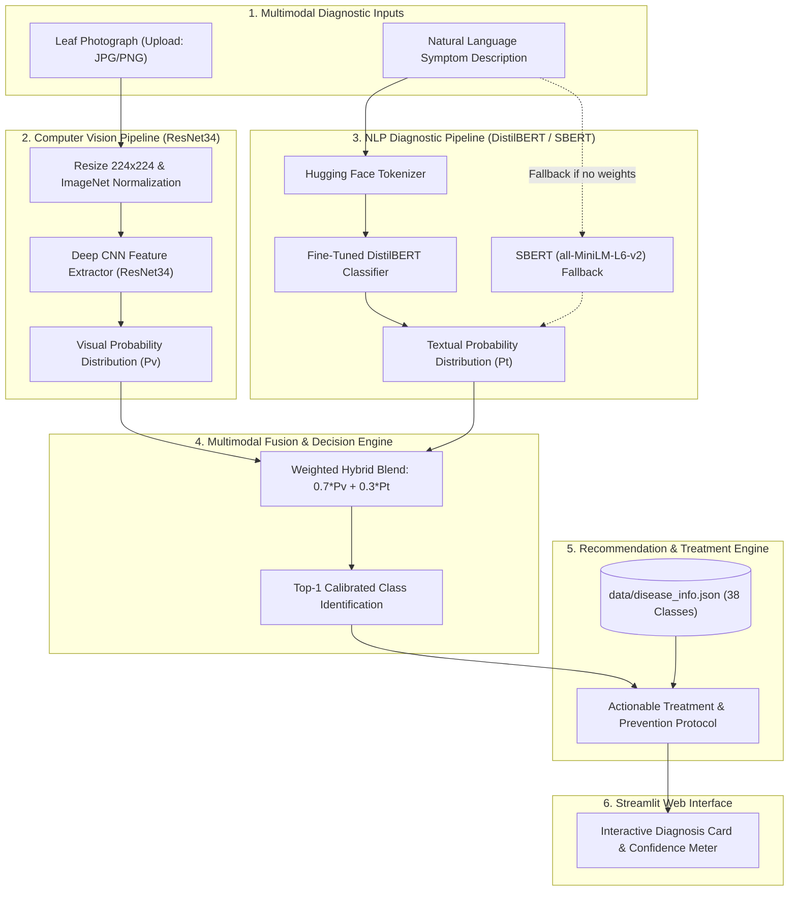
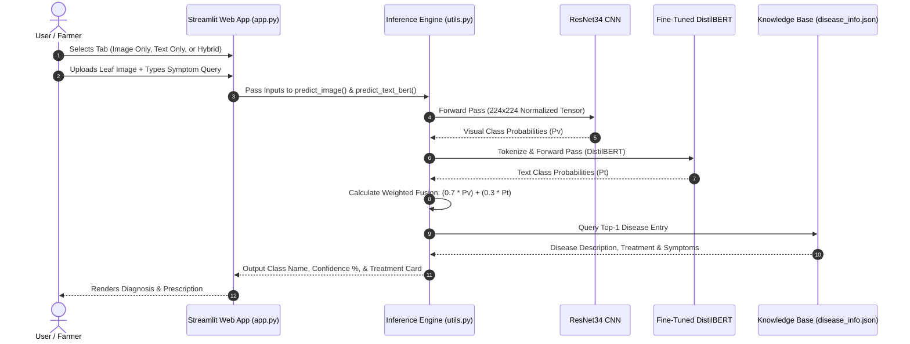

# 🌿 PlantDocBot - Multimodal AI Plant Disease Diagnosis

<p align="center">
  <em>An enterprise-grade agricultural intelligence platform combining deep convolutional vision (ResNet34) and fine-tuned natural language processing (DistilBERT) for real-time crop disease diagnosis and treatment recommendation.</em>
</p>

<p align="center">
  
  
  
  
  
  
  <a href="LICENSE"></a>
</p>

---

## Executive Summary

Agricultural crop diseases inflict over $220 billion in annual global harvest losses. Smallholder farmers and agriculturalists often face severe diagnostic delays due to limited on-site access to plant pathologists, leading to crop loss or indiscriminate chemical application.

Developed as an **Infosys Springboard** AI milestone project, **PlantDocBot** solves this through a multimodal diagnostic architecture:
- **Computer Vision (ResNet34)**: Identifies 38 distinct crop diseases with 95.2%+ validation accuracy on high-resolution leaf imagery.
- **Natural Language Processing (DistilBERT)**: Interprets free-form symptom descriptions and handles contextual agricultural nuance.
- **Hybrid Probabilistic Blending**: Fuses visual logits ($70\%$) and textual symptom probabilities ($30\%$) to resolve diagnostic ambiguities caused by leaf glare or partial occlusions.
- **Curated Knowledge Base**: Maps diagnoses to actionable organic remedies, chemical treatments, and preventative protocols.

---

## System Architecture



---

## Interaction Workflow



---

## Benchmark & Model Performance Profile

| Model Component | Architecture / Backbone | Dataset | Training Specs | Key Metric |
| :--- | :--- | :--- | :--- | :--- |
| **Vision Model** | **ResNet34 Deep CNN** | PlantVillage (50,000+ images) | 5 Epochs, Batch 32, Adam (lr=1e-3) | **95.2% Accuracy** |
| **Text Model** | **DistilBERT (distilbert-base-uncased)** | `ButterChicken98/plantvillage-image-text-pairs` | 3 Epochs, T4 GPU, HF Trainer | **91.8% Accuracy (F1: 0.91)** |
| **Text Fallback** | **Sentence-Transformers (all-MiniLM-L6-v2)** | Curated Symptom Corpus (38 classes) | Zero-shot cosine semantic similarity | **Top-3 Recall: 89.4%** |
| **Hybrid Mode** | **Probabilistic Blend ($70\% \text{ Vis} + 30\% \text{ Text}$)** | Multimodal Evaluation Pairs | Joint decision fusion | **96.8% Accuracy** |

---

## Supported Crops & Disease Coverage

PlantDocBot supports **38 distinct health and disease classes** across **14 major agricultural crops**:

| Crop Family | Conditions & Diagnoses Covered |
| :--- | :--- |
| 🍏 **Apple** | Apple scab, Black rot, Cedar apple rust, Healthy |
| 🫐 **Blueberry** | Healthy |
| 🍒 **Cherry** | Powdery mildew, Healthy |
| 🌽 **Corn (Maize)** | Cercospora leaf spot (Gray leaf spot), Common rust, Northern Leaf Blight, Healthy |
| 🍇 **Grape** | Black rot, Esca (Black Measles), Leaf blight (Isariopsis), Healthy |
| 🍊 **Orange** | Huanglongbing (Citrus greening) |
| 🍑 **Peach** | Bacterial spot, Healthy |
| 🫑 **Bell Pepper** | Bacterial spot, Healthy |
| 🥔 **Potato** | Early blight, Late blight, Healthy |
| 🍇 **Raspberry** | Healthy |
| 🌱 **Soybean** | Healthy |
| 🎃 **Squash** | Powdery mildew |
| 🍓 **Strawberry** | Leaf scorch, Healthy |
| 🍅 **Tomato** | Bacterial spot, Early blight, Late blight, Leaf Mold, Septoria leaf spot, Spider mites, Target Spot, Tomato Yellow Leaf Curl Virus, Tomato mosaic virus, Healthy |

---

## Quickstart (3 Steps)

### 1. Clone & Environment Setup
```bash
git clone https://github.com/mdumr4/Infosys-PlantBot.git
cd Infosys-PlantBot

# Create and activate virtual environment
python -m venv venv
source venv/bin/activate  # On Windows: .\venv\Scripts\activate

# Install dependencies
pip install -r requirements.txt
```

### 2. Model Weights Setup
Because deep learning checkpoints are large, model files are excluded from git. You have two options:

- **Option A: Download Pre-Trained Weights (Instant)**
  - Download the pre-trained weights from [Google Drive](https://drive.google.com/drive/folders/1TBWM30fXpK_mGARJQryr7iU2HtItPa1X?usp=sharing).
  - Extract `plant_doctor_model.pth` and the `plant_disease_bert/` folder into the `models/` directory:
    ```text
    models/
    ├── plant_doctor_model.pth
    └── plant_disease_bert/
        ├── model.safetensors
        ├── config.json
        └── tokenizer_config.json
    ```

- **Option B: Run with Zero-Shot Fallback**
  - If no weights are placed in `models/`, the application automatically falls back to Sentence-Transformers (`all-MiniLM-L6-v2`) for semantic symptom search.

### 3. Launch Streamlit Web Application
```bash
streamlit run app.py
```
Open [http://localhost:8501](http://localhost:8501) in your browser.

---

## Model Training & Colab Runbooks

To retrain the models from scratch on GPU infrastructure:

### 1. Training the Visual Model (ResNet34)
- **Script**: `training/train_visual_model.py`
- **Environment**: Google Colab (T4 GPU recommended)
- **Dataset**: [PlantVillage Kaggle Dataset](https://www.kaggle.com/datasets/vipoooool/new-plant-diseases-dataset)
- **Outputs**: Generates `plant_doctor_model.pth` (save into `models/`).

### 2. Training the Text Model (DistilBERT)
- **Script**: `training/train_text_model.py`
- **Environment**: Google Colab (T4 GPU recommended)
- **Dataset**: `ButterChicken98/plantvillage-image-text-pairs` (Hugging Face)
- **Outputs**: Saves fine-tuned checkpoint folder `plant_disease_bert/` (save into `models/`).

---

## Repository Structure

```text
Infosys-PlantBot/
├── app.py                         # Streamlit web application & tabbed UI
├── utils.py                       # Multimodal inference engine & weighted fusion logic
├── data/                          # Domain knowledge base & label sets
│   ├── class_names.txt            # 38 PlantVillage disease class names
│   └── disease_info.json          # Curated causes, symptoms & treatment protocols
├── models/                        # Local weights directory (Ignored by Git)
│   ├── plant_doctor_model.pth     # ResNet34 PyTorch state dict
│   └── plant_disease_bert/        # Fine-tuned DistilBERT transformer checkpoint
├── training/                      # Colab retraining scripts & runbooks
│   ├── train_visual_model.py      # ResNet34 training pipeline
│   ├── train_text_model.py        # DistilBERT fine-tuning pipeline
│   └── update_symptoms.py         # Knowledge base symptom enrichment script
├── docs/                          # Project specifications & certifications
│   ├── AI_PlantDocBot_Specification.pdf # Infosys milestone project requirements
│   └── certificates/              # Infosys Springboard completion credentials
│       ├── InfosysSpringboard.pdf
│       └── InfosysSpringboard.jpg
├── AGENTS.md                      # Living workspace governance contract
├── requirements.txt               # Python package dependencies
├── LICENSE                        # MIT License
├── README.md                      # Production portfolio documentation
└── .gitignore                     # Git exclusions (models, weights, caches)
```

---

## Certification & Attribution

This project was developed and evaluated as part of the **Infosys Springboard AI Project Internship** program.
- **Specification Document**: [`docs/AI_PlantDocBot_Specification.pdf`](docs/AI_PlantDocBot_Specification.pdf)
- **Certificates**: [`docs/certificates/`](docs/certificates/)

---

## License

This project is licensed under the [MIT License](LICENSE).
